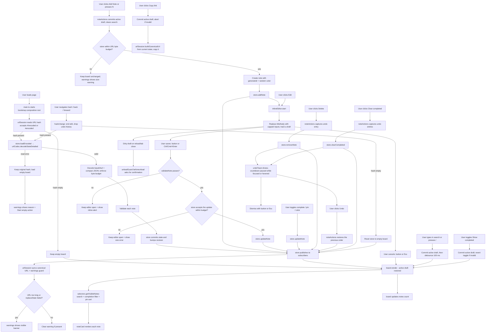

# Application Flow Diagram

## Module Layout

- **Entry point** (`src/main.ts`): Imports `src/styles/app.css`, chooses when to start based on `document.readyState`, and exports `stop()` for teardown. All wiring lives in the composition root, not here.
- **Composition root** (`src/app/bootstrap.ts`): `bootstrap(store = noteStore)` constructs the warnings, undo toast, inline editor, board, toolbar, URL session, and unload guard, then returns an `AppController` whose `destroy()` removes every listener and timer. The board and editor reference each other through a small holder so the dependency stays acyclic; no UI module keeps module-level state.
- **Note model** (`src/notes/model.ts`): `Note`, `NOTE_COLORS`, `NOTE_VALIDATION`, `validateNote`, `normalizeNote`, `cycleColor`, and `randomColor`.
- **Store** (`src/notes/store.ts`): `createNoteStore()` plus a singleton default. Flattened methods (`addNote`, `updateNote`, `removeNote`, `setNotes`, `clearCompleted`, `loadEncoded`, `getEncoded`, `getNotes`, `getState`, `getRevision`, `subscribe`) return typed `MutationResult`/`LoadResult` values instead of throwing. Mutations are validated, budget-checked, committed immutably, and bump a monotonic revision.
- **Selectors** (`src/notes/selectors.ts`): Pure sorting, completion filtering, and Fuse search helpers, plus `createVisibleNotesSelector()`, which owns the Fuse index cache keyed by store revision.
- **Persistence** (`src/persistence/urlCodec.ts`): Compact JSON (`{v,n:[{i,t,b,c,p,k}]}`) → UTF-8 → base64url, decode failure reasons, byte/length budgets, and `generateId`.
- **App services** (`src/app/`): `noteActions.ts` (add/delete/clear-completed and undo capture), `urlSession.ts` (hash load, canonical URL, sync, recovery), `unloadGuard.ts` (dirty-draft `beforeunload`), and `errors.ts` (error reporting).
- **UI factories** (`src/ui/`): `board.ts` renders the visible list and restores the active draft, `inlineEditor.ts` owns the draft lifecycle, `toolbar.ts` wires buttons/search/shortcuts, `noteCard.ts` builds a note element, `warnings.ts` manages the URL/decode banners, `undoToast.ts` manages the undo countdown, and `dom.ts`/`format.ts` hold small helpers.
- **Tests**: Unit tests sit next to the modules they cover (`src/**/*.test.ts`). Whole-app tests live in `tests/` and share `tests/support/appHarness.ts`, which boots the real composition root against the real `index.html` body with a fresh store per test.

## Data Flow

1. **State Management** (`src/notes/store.ts`): A factory creates an immutable state container. Every mutation validates and normalizes the affected note, checks the URL byte budget, and commits by replacing the state object. Rejected mutations leave state untouched, return `{ ok: false, reason: 'invalid' | 'budget' }`, and publish nothing. Committed changes bump a revision and notify subscribers; `getState()`/`getNotes()` return clones so callers cannot mutate internal data.
2. **URL Encoding** (`src/persistence/urlCodec.ts`): Compact JSON (`{v,n:[{i,t,b,c,p,k}]}`) → UTF-8 → base64url. `v` is the schema version (currently 1; links without it are treated as v1, unknown versions are rejected). Decoded on load and on `hashchange`; encoded whenever state changes. The hash reader accepts both `#/<state>` and `#<state>`. `c` marks completed notes, `p` marks pinned notes, and `k` stores an optional note color. Encoded input longer than `MAX_ENCODED_LENGTH` (100,000 characters) is rejected before decoding, and the compact payload is capped at `MAX_STATE_BYTES` (75,000 UTF-8 bytes) so a generated link can always be reopened. `decodeStateDetailed` reports a reason (`too-long`, `invalid-encoding`, `invalid-json`, `invalid-shape`, or `unsupported-version`). Duplicate note ids are dropped so update/remove still target a single note.
3. **URL Session & Guardrails** (`src/app/urlSession.ts`): `buildCanonicalUrl` produces `origin + pathname + search + #/state`, preserving query parameters. The session loads the hash into the store, syncs state changes with `history.replaceState`, and drives the warning banners. If the URL exceeds 16k characters or the browser rejects the update, `ui/warnings.ts` shows a visible `#urlWarning` explaining that the link may be truncated or stale; it clears automatically when the URL becomes short enough again. An unreadable incoming hash is not overwritten: the store stays empty, a `#decodeWarning` explains why and keeps the original link, and only its "Start empty" button clears the hash. Copy link rebuilds the same canonical URL from current state, so it is correct even when `replaceState` failed and the address bar is stale.
4. **UI** (`src/ui/board.ts`, `src/ui/inlineEditor.ts`, `src/ui/toolbar.ts`, `src/ui/noteCard.ts`): Factories subscribe to store changes and render sticky notes with a pure view pipeline (`selectors.getVisibleNotes`: search, completion filter, pinned-first sort). The board supports inline editing with `Esc`/`Ctrl+Enter` shortcuts (Escape works from the Save/Cancel buttons too), completion/pin/color toggles, search, filtering, copy-link, clear-completed, and an undo toast for deletions and clear-completed. The active editor is an `EditDraft` (id, title, body, focused field, caret position): state-change re-renders rebuild the board and re-mount that editor with the draft intact, while search, show-completed, add-note, clear-completed, and copy-link first commit the draft so an external action cannot silently discard typed text. An invalid or over-budget draft aborts the external action (the show-completed checkbox reverts) and keeps the editor and its error visible. `ui/unloadGuard.ts` triggers the browser's `beforeunload` confirmation for a dirty draft. Saving or cancelling returns focus to the note's Edit button. The undo toast pauses while focused or hovered, dismisses with its × button or `Esc`, and resumes with the remaining time; a `hashchange` ends any active edit and drops the undo history because the incoming URL replaces the board.
5. **Search** (`src/notes/selectors.ts`): The single search implementation uses the Fuse.js basic build (no extended-search operators) across title and body. The search input commits any active edit, then is debounced by 100 ms before the board re-renders. `createVisibleNotesSelector()` caches the Fuse index by the store revision counter, since `getNotes()` returns a clone. Visible results respect the active search query, completion filter, and pin priority. The notes count is updated by the board and announces visible vs. total results (e.g. "1 of 5 notes").
6. **Pin priority**: Notes can be pinned to stay at the top of the displayed list (pinned notes sort first; relative order preserved within groups). Pin state is stored in the URL.
7. **Keyboard shortcuts**: `N` adds a note, `/` focuses search, `Esc` cancels an inline edit, and `Ctrl/Cmd+Enter` saves one. Shortcuts are ignored while typing in an input or textarea.
