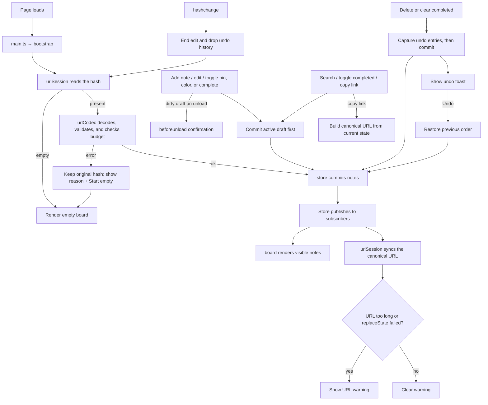

# Application Flow

## Modules

| Area | Responsibility |
| --- | --- |
| `src/main.ts` | Entry point: imports CSS, starts `bootstrap()`, exports `stop()`. |
| `src/app/bootstrap.ts` | Composition root; returns an `AppController` with `destroy()`. |
| `src/app/urlSession.ts` | Hash loading, canonical URL, URL sync, and decode recovery. |
| `src/app/noteActions.ts`, `unloadGuard.ts`, `errors.ts` | Add/delete/clear actions, dirty-draft guard, error reporting. |
| `src/notes/model.ts` | Note type, validation, colors, and id/color helpers. |
| `src/notes/store.ts` | Immutable state, mutations, budget checks, revision, subscriptions. |
| `src/notes/selectors.ts` | Search, completion filter, pin sort, and revision-cached selector. |
| `src/persistence/urlCodec.ts` | Compact schema, base64url encode/decode, budgets, `generateId`. |
| `src/ui/*` | Factories for the board, inline editor, toolbar, note card, warnings, and undo toast. |

## Behavior Notes

- **URL state**: schema `v: 1` is required; compact keys `i`/`t`/`b`/`c`/`p`/`k`. Links use the canonical `#/...` hash and the base64url alphabet; duplicate ids, padding, missing versions, unknown versions, and malformed input are rejected.
- **Budgets**: the payload is capped at 75,000 UTF-8 bytes, which guarantees a link at or below the 100,000-character decode limit. Rejected mutations leave the board unchanged and report `invalid` or `budget`.
- **Editing**: state-change renders re-mount the active `EditDraft`; actions outside the editor commit the draft first. An invalid or over-budget draft cancels the action and keeps the editor open.
- **Ordering**: pinned notes sort first, with relative order preserved; completed notes are hidden unless "Show completed" is enabled.
- **Tests**: unit tests are colocated in `src/`; whole-app tests live in `tests/` and share `tests/support/appHarness.ts`, which boots against the real `index.html` body.
