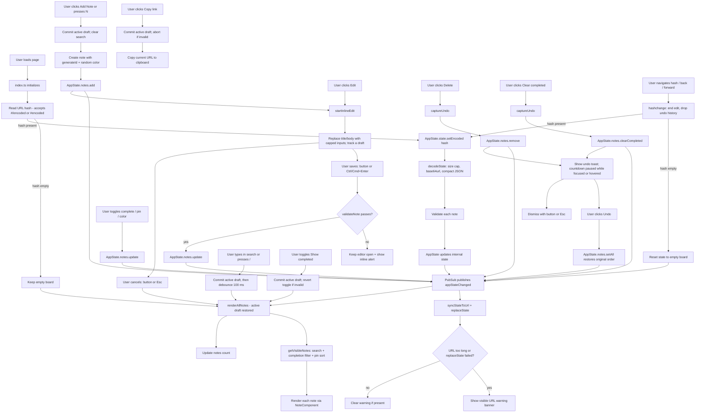

# Application Flow Diagram

## Data Flow

1. **State Management** (`src/state/appState.ts`): Singleton factory pattern with immutable updates. All state changes go through `setState()` which clones, normalizes, validates notes, and publishes `appStateChanged`. Invalid adds/updates are rejected; the UI validates before calling them so users see an inline error instead of a silent no-op.
2. **URL Encoding** (`src/utils/urlState.ts`): Compact JSON (`{v,n:[{i,t,b,c,p,k}]}`) → UTF-8 → base64url. `v` is the schema version (currently 1; links without it are treated as v1, unknown versions are rejected). Decoded on load and on `hashchange`; encoded whenever state changes. The hash reader accepts both `#/<state>` and `#<state>`. `c` marks completed notes, `p` marks pinned notes, `k` stores an optional note color. Encoded input longer than `MAX_ENCODED_LENGTH` is discarded before decoding, and duplicate note ids are dropped so update/remove still target a single note.
3. **URL Sync & Guardrails** (`src/index.ts`): `syncStateToUrl` writes `pathname + search + #/state` with `history.replaceState`, preserving query parameters. If the URL exceeds 16k characters, or the browser rejects the update, a visible `#urlWarning` banner explains that the link may be truncated or stale. The banner clears automatically when the URL becomes short enough again.
4. **UI** (`src/index.ts`, `src/components/note.ts`, `src/utils/view.ts`): Event-driven, subscribes to `appStateChanged`. Renders sticky notes on a corkboard with a pure view pipeline (`getVisibleNotes`: search, completion filter, pinned-first sort), supports inline editing with `Esc`/`Ctrl+Enter` shortcuts (Escape works from the Save/Cancel buttons too), completion/pin/color toggles, search, filtering, copy-link, clear-completed, and an undo toast for deletions and clear-completed. The active editor is an `EditDraft` (id, title, body, focused field, caret position): state-change re-renders rebuild the board and re-mount that editor with the draft intact, while search, show-completed, add-note, clear-completed, and copy-link first commit the draft so an external action cannot silently discard typed text. An invalid draft aborts the external action (the show-completed checkbox reverts) and keeps the editor and its error visible. Saving or cancelling returns focus to the note's Edit button. The undo toast pauses while focused or hovered, dismisses with its × button or `Esc`, and resumes with the remaining time; a `hashchange` ends any active edit and drops the undo history because the incoming URL replaces the board.
5. **Search** (`src/utils/view.ts`): The single search implementation uses the Fuse.js basic build (no extended-search operators) across title and body. The search input commits any active edit, then is debounced by 100 ms before the board re-renders. The Fuse index is cached by the AppState revision counter, since `notes.getAll()` returns a clone. Visible results respect the active search query, completion filter, and pin priority. The notes count is updated inside `renderAllNotes` and announces visible vs. total results (e.g. "1 of 5 notes").
6. **Pin priority**: Notes can be pinned to stay at the top of the displayed list (pinned notes sort first; relative order preserved within groups). Pin state is stored in the URL.
7. **Keyboard shortcuts**: `N` adds a note, `/` focuses search, `Esc` cancels an inline edit, and `Ctrl/Cmd+Enter` saves one. Shortcuts are ignored while typing in an input or textarea.
