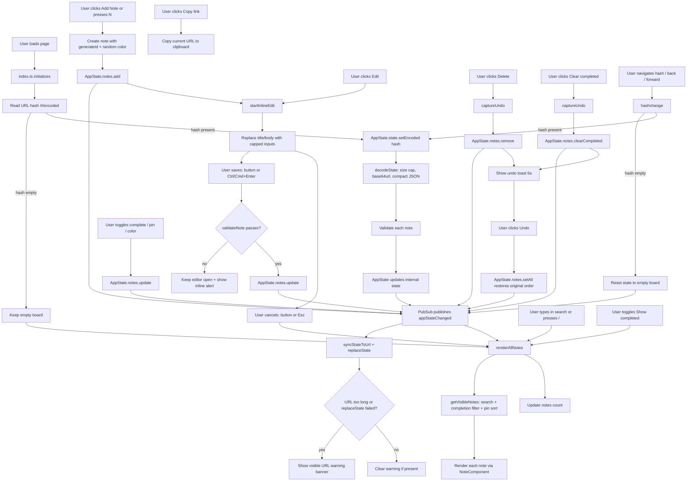

# Application Flow Diagram

## Data Flow

1. **State Management** (`src/state/appState.ts`): Singleton factory pattern with immutable updates. All state changes go through `setState()` which clones, normalizes, validates notes, and publishes `appStateChanged`. Invalid adds/updates are rejected; the UI validates before calling them so users see an inline error instead of a silent no-op.
2. **URL Encoding** (`src/utils/urlState.ts`): Compact JSON (`{n:[{i,t,b,c,p,k}]}`) → UTF-8 → base64url. Decoded on load and on `hashchange`; encoded whenever state changes. `c` marks completed notes, `p` marks pinned notes, `k` stores an optional note color. Encoded input longer than `MAX_ENCODED_LENGTH` is discarded before decoding.
3. **URL Sync & Guardrails** (`src/index.ts`): `syncStateToUrl` writes the encoded state with `history.replaceState`. If the URL exceeds 16k characters, or the browser rejects the update, a visible `#urlWarning` banner explains that the link may be truncated or stale. The banner clears automatically when the URL becomes short enough again.
4. **UI** (`src/index.ts`, `src/components/note.ts`, `src/utils/view.ts`): Event-driven, subscribes to `appStateChanged`. Renders sticky notes on a corkboard with a pure view pipeline (`getVisibleNotes`: search, completion filter, pinned-first sort), supports inline editing (tracked by `editingId`) with `Esc`/`Ctrl+Enter` shortcuts, completion/pin/color toggles, search, filtering, copy-link, clear-completed, and an undo toast for deletions and clear-completed.
5. **Search** (`src/utils/view.ts`): The single search implementation uses Fuse.js for fuzzy search across title and body. The search input is debounced by 100 ms before the board re-renders. Visible results respect the active search query, completion filter, and pin priority. The notes count is updated inside `renderAllNotes`.
6. **Pin priority**: Notes can be pinned to stay at the top of the displayed list (pinned notes sort first; relative order preserved within groups). Pin state is stored in the URL.
7. **Keyboard shortcuts**: `N` adds a note, `/` focuses search, `Esc` cancels an inline edit, and `Ctrl/Cmd+Enter` saves one. Shortcuts are ignored while typing in an input or textarea.
