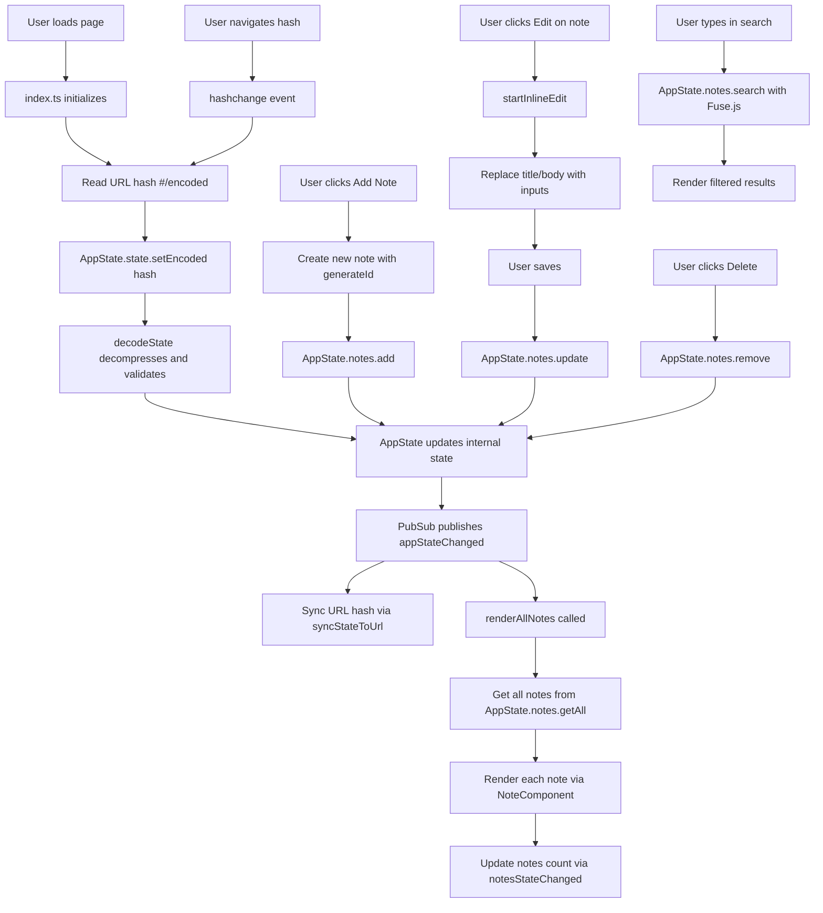

# Application Flow Diagram

## Data Flow

1. **State Management** (`src/state/appState.ts`): Singleton factory pattern with immutable updates. All state changes go through `setState()` which clones, normalizes, publishes events.
2. **URL Encoding** (`src/utils/urlState.ts`): Compact JSON (`{n:[{i,t,b}]}`) → UTF-8 → base64url. Decoded on load, encoded on changes.
3. **UI** (`src/index.ts`, `src/components/note.ts`): Event-driven, subscribes to pubsub events. Renders sticky notes, supports inline editing and search.
4. **Search** (`AppState.notes.search`): Uses Fuse.js for fuzzy search across title and body.
