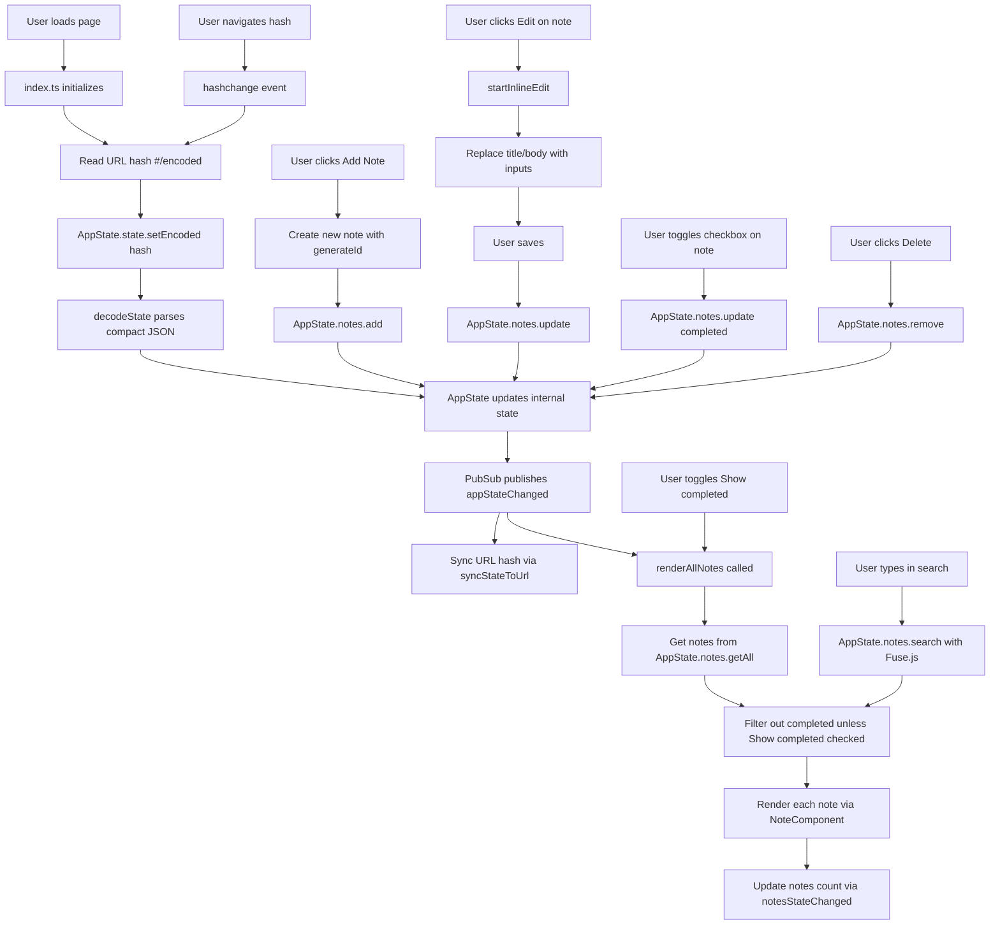

# Application Flow Diagram

## Data Flow

1. **State Management** (`src/state/appState.ts`): Singleton factory pattern with immutable updates. All state changes go through `setState()` which clones, normalizes, and publishes events.
2. **URL Encoding** (`src/utils/urlState.ts`): Compact JSON (`{n:[{i,t,b,c}]}`) → UTF-8 → base64url. Decoded on load, encoded on changes. `c` marks completed notes.
3. **UI** (`src/index.ts`, `src/components/note.ts`): Event-driven, subscribes to pubsub events. Renders sticky notes on a corkboard, supports inline editing, completion toggles, search, and filtering.
4. **Search** (`AppState.notes.search`): Uses Fuse.js for fuzzy search across title and body. Results are filtered to hide completed notes unless "Show completed" is checked.
5. **Completion**: Each note can be marked completed via checkbox. Completed notes show a large red "X" overlay and are hidden by default.
