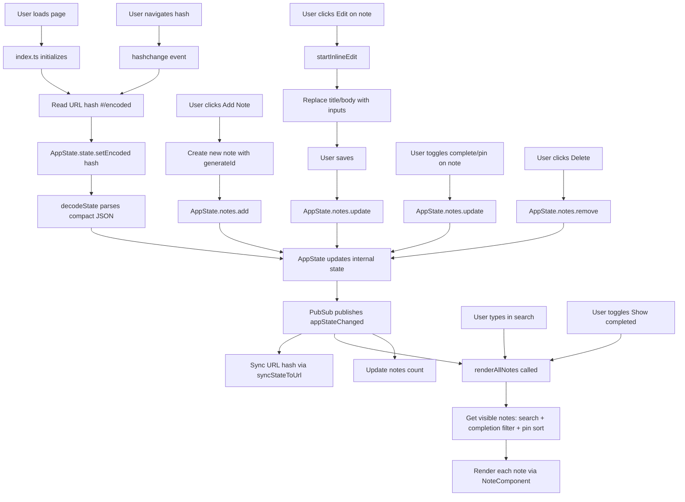

# Application Flow Diagram

## Data Flow

1. **State Management** (`src/state/appState.ts`): Singleton factory pattern with immutable updates. All state changes go through `setState()` which clones, normalizes, and publishes `appStateChanged`.
2. **URL Encoding** (`src/utils/urlState.ts`): Compact JSON (`{n:[{i,t,b,c,p}]}`) → UTF-8 → base64url. Decoded on load, encoded on changes. `c` marks completed notes, `p` marks pinned notes.
3. **UI** (`src/index.ts`, `src/components/note.ts`): Event-driven, subscribes to `appStateChanged`. Renders sticky notes on a corkboard with a unified view pipeline (search, completion filter, pinned-first sort), supports inline editing, completion/pin toggles, search, and filtering.
4. **Search** (`AppState.notes.search`): Uses Fuse.js for fuzzy search across title and body. Visible results respect the active search query, completion filter, and pin priority.
5. **Pin priority**: Notes can be pinned to stay at the top of the displayed list (pinned notes sort first; relative order preserved within groups). Pin state is stored in the URL.
