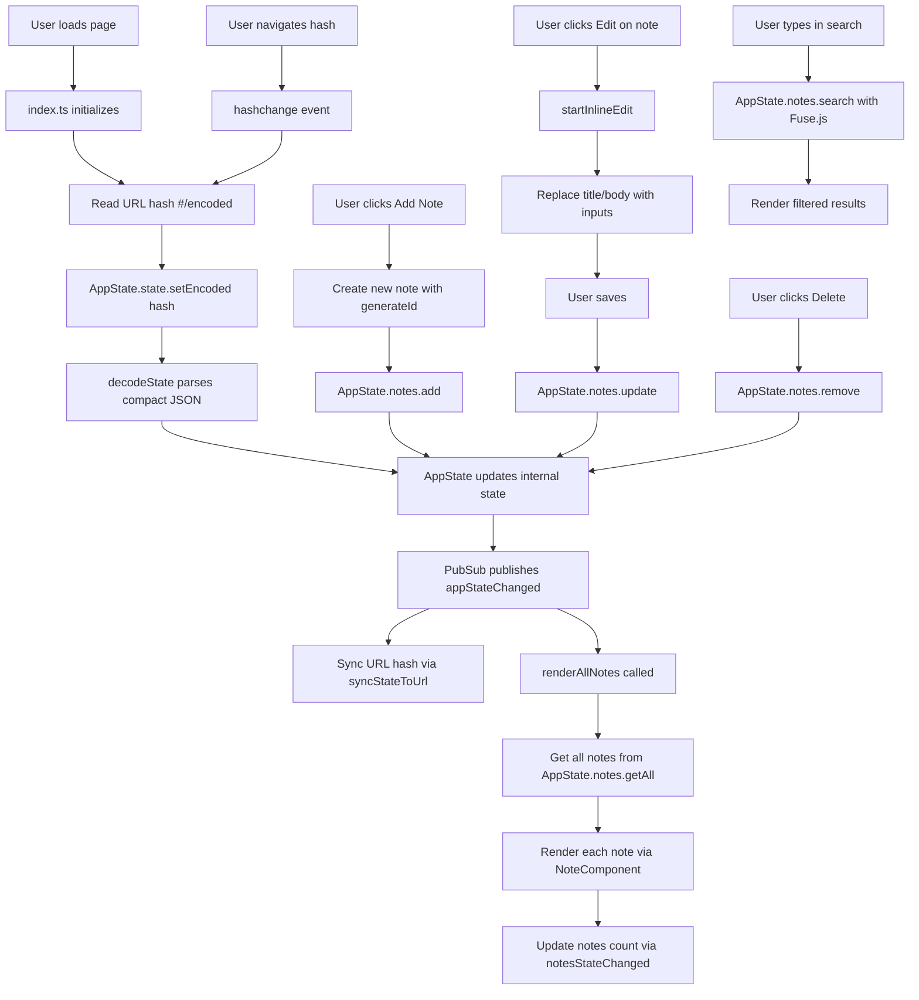

# Base64 Encoded State Test

[](https://app.netlify.com/projects/vigorous-wilson-ce6cfa/deploys)

A vanilla TypeScript sticky note web app that persists all application state in the URL hash as compressed, base64url-encoded data. Share notes by simply sharing the URL.

## Features

- **Sticky Note UI** - Notes displayed as colorful sticky cards in a grid layout
- **Add Notes** - Click "Add Note" to create a new note and edit inline
- **Inline Editing** - Click edit on any note to modify title and body in place (one note at a time)
- **Delete Notes** - Remove notes with the delete button
- **Search** - Fuzzy search across note titles and bodies using Fuse.js
- **URL State Persistence** - Entire app state is encoded in the URL hash for easy sharing and bookmarking
- **No Backend Required** - Fully client-side application

## Tech Stack

- **Language**: TypeScript 5.9
- **Build Tool**: Vite 6
- **Styling**: CSS3
- **Search**: Fuse.js
- **ID Generation**: nanoid
- **Testing**: Jest 30 with jsdom

## Getting Started

### Development

```bash
npm install
npm run dev
```

### Build

```bash
npm run build
npm run preview
```

### Testing

```bash
npm test
npm run test:watch
npm run test:coverage
```

## How It Works

Application state (all notes) is serialized, compacted with short keys, encoded as UTF-8, converted to base64url, and stored in the URL hash (`#/...`). On page load or hash change, the state is decoded and restored. Any state change automatically updates the URL.

See [APP_FLOW.md](./APP_FLOW.md) for a detailed flow diagram.

## Application Flow


