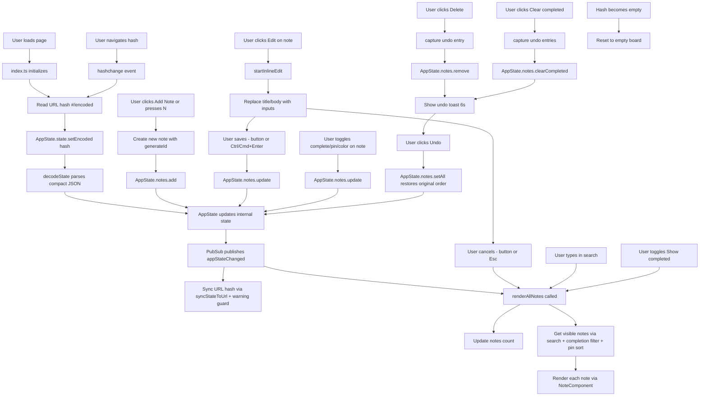

# Base64 Encoded State Test

[](https://app.netlify.com/projects/vigorous-wilson-ce6cfa/deploys)

A vanilla TypeScript sticky note web app that persists all application state in the URL hash as base64url-encoded data. Share notes by simply sharing the URL.

## Features

- **Corkboard UI** - Notes displayed as colorful sticky cards on a corkboard background
- **Add Notes** - Click "Add Note" to create a new note and edit inline
- **Inline Editing** - Click edit on any note to modify title and body in place (one note at a time)
- **Keyboard Shortcuts** - `N` new note, `/` focus search, `Esc` cancel edit, `Ctrl/Cmd+Enter` save edit
- **Pin to Top** - Pin notes to keep them prioritized at the top of the board
- **Note Colors** - Cycle a note through a small sticky-note color palette
- **Complete Notes** - Mark notes as completed with a checkbox; completed notes show a large red "X" overlay
- **Show/Hide Completed** - Toggle visibility of completed notes (hidden by default)
- **Clear Completed** - Remove all completed notes in one action
- **Undo** - Deleted a note by accident? An undo toast appears for 6 seconds after deletions and clear-completed
- **Empty States** - Context-aware guidance when there are no notes, no search matches, or all notes are completed
- **Copy Share Link** - Copy the current URL (with full note state) to the clipboard
- **Delete Notes** - Remove notes with the delete button
- **Search** - Debounced fuzzy search across note titles and bodies using Fuse.js
- **URL State Persistence** - Entire app state is encoded in the URL hash for easy sharing and bookmarking
- **No Backend Required** - Fully client-side application

## Tech Stack

- **Language**: TypeScript 5.9
- **Build Tool**: Vite 6
- **Styling**: CSS3
- **Search**: Fuse.js
- **ID Generation**: nanoid
- **Testing**: Jest 30 with jsdom

## Getting Started

### Development

```bash
npm install
npm run dev
```

### Build

```bash
npm run build
npm run preview
```

### Testing

```bash
npm test
npm run test:watch
npm run test:coverage
```

## How It Works

Application state (all notes) is serialized, compacted with short keys (`i` id, `t` title, `b` body, `c` completed, `p` pinned, `k` color), encoded as UTF-8, converted to base64url, and stored in the URL hash (`#/...`). On page load or hash change, the state is decoded and restored. Any state change automatically updates the URL; if the link grows past 16k characters (or the browser refuses the history update), a visible warning banner explains that the link may not be shareable.

See [APP_FLOW.md](./APP_FLOW.md) for a detailed flow diagram.

## Privacy

The URL state is **encoded, not encrypted**. Anyone who has a shared link can read every note in it, and URLs may be retained in browser history, chat apps, email clients, and server access logs. Don't put secrets in a note.

## Deployment

The build is fully static, so any static host works.

### Netlify

The repository includes `netlify.toml` with the build command (`npm run build`), publish directory (`dist`), and baseline security headers. Connect the repository in Netlify and deploy; no environment variables are required. Netlify uses the Node version from `.nvmrc`.

### Other static hosts

Run `npm run build` and upload the contents of `dist/`. Because every route lives in the URL hash, no server rewrite rules are needed.

## Application Flow



## License

ISC — see [LICENSE](./LICENSE).
